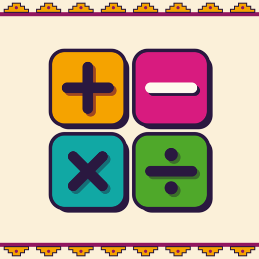
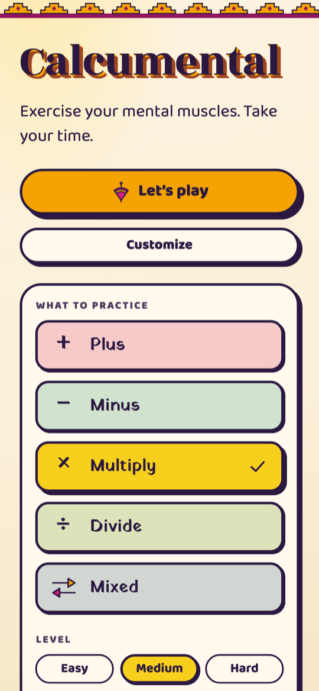
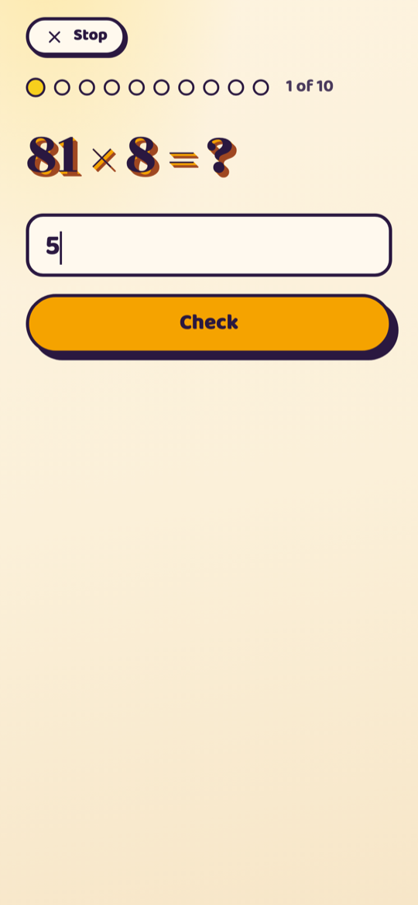
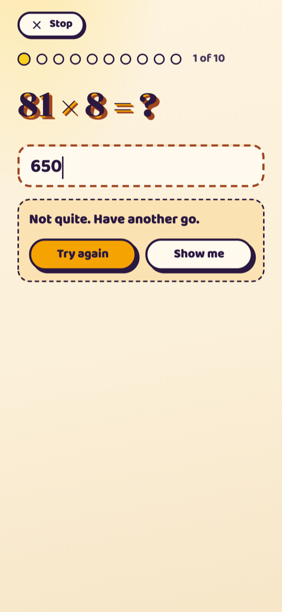

<!-- Header block for project -->
<hr>

<div align="center">



<h1 align="center">Calcumental</h1>

</div>

<pre align="center">Exercise your mental muscles: arithmetic puzzles at your own pace, with no streaks, scores or timers.</pre>

<!-- Header block for project -->

[](LICENSE) [](https://github.com/riverma/calcumental/releases/latest) [](https://github.com/riverma/calcumental/actions/workflows/pages.yml) [](https://nasa-ammos.github.io/slim/)

<table align="center">
  <tr>
    <td></td>
    <td></td>
    <td></td>
    <td></td>
  </tr>
</table>

Calcumental asks one arithmetic question at a time, waits as long as you like, and does not judge how you did. Plus, minus, times, divide or a mix, at three levels, in English, Español and हिन्दी. It works offline, on your own device, and keeps nothing but your settings. It was made for a young girl in Mexico who loved numbers and wanted more arithmetic to practise.

One Flutter codebase builds the **iPhone app**, the **Android app** and the **web app**, all on the [Khelo design system](https://github.com/riverma/khelo-design) v1.0.0: Mela by day, Raat by night, following the system unless you choose. It is a recreation of [riverma/math](https://github.com/riverma/math) with the same puzzles and Khelo's rules of play. A set has a visible length and a real end. A wrong answer is "not quite", with another go.

[Website](https://calcumental.riverma.com) | [Play online](https://calcumental.riverma.com/play/) | [Privacy policy](https://calcumental.riverma.com/privacy/) | [Latest release](https://github.com/riverma/calcumental/releases/latest) | [Issue Tracker](https://github.com/riverma/calcumental/issues)

## Features

* Four operations and a mixed mode, at three levels (Easy, Medium, Hard).
* The bigger number always comes first, so you see 11 × 9, not 9 × 11.
* "Close enough" mode for practising estimation: an answer within 5% counts.
* A wrong answer is just another go: start typing a new answer, press Try again, or choose Show me.
* No streaks, scores, timers or red marks, and nothing appears unasked.
* Offline: no network requests, no analytics, no ads, no accounts.
* English, Español and हिन्दी, with a light look (Mela) and a dark look (Raat).
* Big full-width buttons that are easy to hit with a thumb.

## Contents

* [Quick Start](#quick-start)
* [Changelog](#changelog)
* [FAQ](#frequently-asked-questions-faq)
* [Contributing Guide](#contributing)
* [License](#license)
* [Support](#support)

## Quick Start

This guide provides a quick way to get started with the project. The [website](https://calcumental.riverma.com) has the app, its FAQ and its privacy policy.

### Requirements

* [Flutter](https://docs.flutter.dev/get-started/install), a stable release with Dart 3.9 or later.
* For iOS: Xcode and an Apple developer team (a free Personal Team works for your own phone).
* For Android: the Android SDK, and JDK 17.
* For the website: Python 3.

### Setup Instructions

1. Clone the repository: `git clone https://github.com/riverma/calcumental.git && cd calcumental`
2. Turn off usage reporting, which the CLI otherwise does: `flutter --disable-analytics && dart --disable-analytics`
3. Install the packages: `flutter pub get`
4. For an iPhone, first choose your own Apple team in Xcode (Runner, Signing & Capabilities). With a free Personal Team, builds expire after 7 days; rebuild to refresh.

### Run Instructions

```sh
flutter run                  # a simulator, a connected iPhone or an Android device
flutter run -d chrome        # the web app
```

The app opens on the menu. Press **Let's play** to start a set.

### Usage Examples

* Press **Let's play** to start a set, or **Customize** to choose the operation, the level, how close an answer must be, and how many problems.
* Type an answer and press **Check**. If it is not quite right, just start typing a new answer, or press **Try again** or **Show me**.
* Switch language (English, Español, हिन्दी) and look (Mela, Raat) on the menu.

### Build Instructions

**Web**

```sh
flutter build web --no-web-resources-cdn --pwa-strategy=none --release
dart run tool/build_sw.dart          # precache everything, so it opens with the radio off
dart run tool/check_offline.dart     # fails on any reference to another origin
```

**iPhone, for your own device**

```sh
flutter build ios --release
xcrun devicectl device install app --device <device id> build/ios/iphoneos/Runner.app
```

**Android**

```sh
flutter build apk --release      # build/app/outputs/flutter-apk/app-release.apk
```

Release builds are signed with the key described in the file that the `CALCUMENTAL_SIGNING_PROPERTIES`
environment variable points to. Keep that file, and the keystore it names, outside the project. It holds
`storeFile`, `storePassword`, `keyAlias` and `keyPassword`. Without the variable, the build falls back to
the debug key, which is fine for trying the app but not for sharing. The APK is not on Google Play; the
website links to the latest GitHub release instead.

For a release, `CALCUMENTAL_SIGNING_PROPERTIES=<settings file> tool/android_release.sh` builds the APK as
`build/release/Calcumental.apk`, writes `Calcumental.apk.sha256` beside it and prints the checksum and signer
fingerprint. Attach both files to the GitHub release and paste the checksum into its notes. The website's
"How can I verify the Android download?" answer lists the signer fingerprint, which never changes between
releases.

**iOS App Store**

```sh
CALCUMENTAL_IOS_SIGNING=<settings file> tool/ios_release.sh   # build/ios/ipa/Calcumental.ipa, ready for Transporter
```

Raise the build number in `pubspec.yaml` (`version: X.Y.Z+N`) and commit it first; every upload needs a
higher `N`. The settings file holds your team, as in `ios/Flutter/Signing.example.xcconfig`; keep it outside
the project.

**Website**

`docs/` is the landing page and privacy policy, published with the web app (at `/play/`) by
`.github/workflows/pages.yml`. The landing pages in English, Spanish and Hindi are generated: edit
`tool/site/build.py`, then run `python3 tool/site/build.py`.

### Test Instructions

```sh
flutter test                                  # core, the whole game, the small-screen guard
dart run tool/check_attention.dart            # nothing appears unasked, moves alone or counts
dart run tool/check_licenses.dart
CAPTURE=1 flutter test test/capture           # screenshots for review, in build/shots/
```

`test/small_screen_test.dart` plays every screen at 375×667 and 375×812, at normal and very
large text, in Mela and Raat, in all three languages. It fails on any overflow or any word
split across lines.

### Layout

| Path | What it is |
| --- | --- |
| `lib/core` | Pure Dart: the puzzle generators, a finite session, settings. |
| `lib/l10n` | Every word the app says, in English, Spanish and Hindi. |
| `lib/design` | Khelo in Flutter: tokens, type, the ground and kangura, icons, components. |
| `lib/screens` | The menu, play, and the ending. |
| `lib/game.dart` | The one controller, and where settings are saved (this device only). |
| `web/` | The page shell: a strict CSP, local fallback fonts, the manifest. |
| `docs/` | The website and privacy policy. |
| `tool/` | Build checks (attention, offline, licences, the service worker), release scripts, the site generator, the icon source. |

## Changelog

See our [CHANGELOG.md](CHANGELOG.md) for a history of our changes.

See our [releases page](https://github.com/riverma/calcumental/releases) for our key versioned releases.

## Frequently Asked Questions (FAQ)

Questions about the app? Please see the [FAQ on the website](https://calcumental.riverma.com/#faq). A few answers:

1. Does it collect any data?
   - No. There are no accounts, no analytics and no ads, and the app makes no network requests. It remembers only your choices (language, look, what to practise), on your own device. See the [privacy policy](https://calcumental.riverma.com/privacy/).
2. Why isn't it on Google Play?
   - Google Play asks new personal developer accounts to run a closed test with at least 12 testers for 14 days before an app can be published. That is a lot of overhead for a free open source app, so the Android version is a [direct APK download](https://github.com/riverma/calcumental/releases/latest).
3. How do I check the Android download?
   - Compare the file's SHA-256 checksum with the one in the release notes, and check the signer with `apksigner verify --print-certs`. The [website FAQ](https://calcumental.riverma.com/#faq) has the steps and the signer fingerprint.

## Contributing

Interested in contributing to Calcumental? Here is how:

1. Create a GitHub issue ticket describing what you need, using one of the [issue templates](https://github.com/riverma/calcumental/issues/new/choose).
2. [Fork](https://github.com/riverma/calcumental/fork) this repo.
3. Make your modifications in your own fork. Run `flutter analyze` and `flutter test` first, and the `tool/check_*.dart` checks. The app keeps a few rules: no timers, streaks, scores or anything that moves on without you, and no network access (see `AGENTS.md`).
4. Make a pull request in this repo with the code in your fork and tag the repo owner as a reviewer.

**Working on your first pull request?** See guide: [How to Contribute to an Open Source Project on GitHub](https://kcd.im/pull-request)

## License

Calcumental is licensed under the AGPL-3.0-or-later. See our: [LICENSE](LICENSE). Khelo's tokens and icons are MIT, and the fonts are under the SIL Open Font License 1.1. See [NOTICE](NOTICE).

## Support

Key point of contact: [@riverma](https://github.com/riverma)
